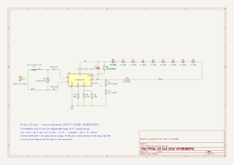

# Philips LED bulb – driver reverse engineering

A schematic of the LED board inside a Philips mains LED bulb, traced from the PCB (board ID **KT-G22366**, marked **9X2835/9S1P**). It was drawn in KiCad and checked against the KP18106WPA datasheet.

> ⚠️ **Mains voltage.** This board is not isolated from the mains. Every part of it, including the LEDs, sits at mains potential while it is plugged in. Never touch or probe it while it is connected.



## Files

| File | Contents |
|------|----------|
| `philips_led_bulb.kicad_sch` | Schematic |
| `philips_led_bulb.kicad_sym` | Custom symbol for the KP18106WPA |
| `philips_led_bulb.pdf`, `philips_led_bulb.svg` | Schematic exports (PDF / SVG) |
| `KP18106WPA_datasheet.pdf` | Original datasheet (Chinese) |
| `KP18106WPA_datasheet_notes.md` | English notes from the datasheet |

## Overview

The bulb uses a **linear constant-current driver**. It has no switching converter, inductor or transformer. The entire circuit is one IC, nine LEDs, one capacitor and seven resistors:

```
  Mains ──F1──┬────────┐        HV (~325 V peak)
              │        │   ┌──────────┬──────┬──────────────────────┐
             RV1    ┌──┴───┴──┐       │      │                      │
              │     │ KP18106 │      C1     R1     D1 → D2 → … → D9 (HV LEDs)
  Mains ──────┴─────┤ bridge  │       │      │                      │
                    │ + 2×CC  ├─COUT──┴──────┘                      │
                    │ MOSFETs ├─LED─────────────R7 (0 Ω)────────────┘
                    └─┬──┬──┬─┘
                     RSL RCS VT ── R2/R3 divider
                      │  │
                     R4  R5∥R6
                      └──┴── GND
```

### 1. Mains input
- **F1:** a fuse in the wire inside the E27 base, not on the board.
- **RV1:** an unmarked black SMD part across L and N. It is a varistor or TVS diode that clamps mains surges.
- The **bridge rectifier is inside the IC.** The KP18106WPA has an integrated 800 V bridge, so the mains goes straight into pins 1 (N) and 8 (L). The rectified high voltage comes out on pin 7 (**HV**).

### 2. High-voltage LED string
- Nine **high-voltage 2835 LEDs** in one series string (`9S1P`). Each LED package holds several dies in series and drops roughly 25–30 V, so the string needs about 250–280 V.
- That is close to the rectified mains peak (230 V AC × √2 ≈ 325 V). A linear regulator only has to drop the small difference, so it can run efficiently without any switching parts.

### 3. Constant LED current (RCS pin)
- An internal MOSFET sits between the end of the LED string (pin 5, **LED**) and GND. The chip holds the voltage across the sense resistor on **RCS** at 0.6 V.
- R_CS = 51 Ω ∥ 39 Ω ≈ 22 Ω, so **I_LED ≈ 0.6 V / 22 Ω ≈ 27 mA**.
- At about 270 V string voltage that is roughly 7 W, typical for a 60 W-equivalent bulb.
- **R7** is a 0 Ω jumper. It only lets the LED trace cross the GND trace on the single-sided PCB.

### 4. Flicker-free storage capacitor (COUT / RSL)
A plain linear driver lets the LEDs go dark every time the rectified mains drops below the string voltage, 100 times a second at 50 Hz. That is visible flicker. This chip avoids it with an electrolytic capacitor:

- **C1** (in the base) connects between **HV** (+) and **COUT** (−, pin 6). COUT is a second internal MOSFET to GND.
- **Charging:** near the mains peak, the COUT MOSFET lets C1 charge with a *limited* current. The limit is set on **RSL** by R4: **0.6 V / 10 Ω ≈ 60 mA**. Because the charging current is capped instead of drawn in a sharp spike at the peak, the input current waveform is spread out. That is what gives the high power factor (PF > 0.7) and lets the bulb meet IEC 61000-3-2.
- **Discharging:** when the mains voltage falls, the bridge stops conducting and C1 keeps the HV bus up. Its return current flows back through the COUT MOSFET's body diode. The LED MOSFET still regulates 27 mA, so the light output stays constant: **no flicker**.
- **R1** (1.5 MΩ) is a bleeder resistor. It drains C1 after switch-off.

### 5. Charging-current compensation (VT pin)
- **R2/R3** (5.6 MΩ / 11 kΩ) divide the **LED pin** voltage down to the VT pin. The ratio is about 1/510, so 300 V becomes about 0.6 V.
- The LED pin voltage equals the excess voltage the LED MOSFET has to burn off. The chip uses it to adjust the capacitor charging current, which keeps power loss in the IC down when the mains voltage is high. *(This is inferred from the datasheet's short description: "electrolytic charging-current compensation".)*

### 6. Protection
- Over-temperature protection: above about 145 °C junction temperature, the chip reduces the LED current.
- The input surge is clamped by RV1 and limited by F1.

## Bill of materials

| Ref | Value | Marking | Notes |
|-----|-------|---------|-------|
| U1 | KP18106WPA | `KP18106WP` | Kiwi Instruments, HSOP-8, LCSC C2692496 |
| D1–D9 | HV 2835 LED | – | Series string |
| C1 | Electrolytic, value ? | – | In the base, off-board |
| R1 | 1.5 MΩ | `1504` | C1 bleeder |
| R2 | 5.6 MΩ | `5604` | VT divider (top) |
| R3 | 11 kΩ | `1102` | VT divider (bottom) |
| R4 | 10 Ω | `10R0` | RSL: charging current ≈ 60 mA |
| R5 | 51 Ω | `51R0` | RCS, parallel with R6 |
| R6 | 39 Ω | `39R0` | RCS: I_LED ≈ 27 mA |
| R7 | 0 Ω | `0` | Jumper |
| RV1 | Varistor/TVS | – | Unmarked black SMD, across L–N |
| F1 | Fuse | – | In the base wire |

## Failure analysis (this unit)

U1 has a **crater in the package near pins 6–7** (the COUT/HV side), so it failed from overheating or overstress. Likely causes:
- **A shorted LED:** each shorted HV LED adds about 25–30 V that U1 must burn off at 27 mA, which is another 0.7–0.8 W in a chip rated 1.5 W at 50 °C.
- **A mains surge**
- **Heat** from an enclosed fitting

Check the LEDs and C1 before fitting a new KP18106WPA.

## Open questions
- C1 value and voltage rating (not yet read)
- Confirm by continuity that D9's cathode reaches pin 5 through R7
